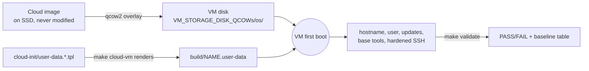

# kvm-setup

Makefile-driven KVM/libvirt lab for an Omarchy (Arch-based) host, This baseline setup should work any linux distro and can be tweaked if needed. It builds the personal Linux environment required by **DEVOPS-006: Provision Linux Development Environment** (Advanced DevOps Engineering, Sprint 1, Week 2), with disks on an external SSD and a cloud-init file that installs the base tools the same way every time.


## What you get



```text
linux-devops-lab/
├── Makefile                          # VM lifecycle + cloud-vm / validate / rebuild
├── cloud-init/
│   ├── user-data.debian.tpl          # Ubuntu Server LTS + Debian (guide baseline)
│   └── user-data.rhel.tpl            # RHEL (see caveats)
├── scripts/validate.sh               # read-only checks + baseline report
└── build/                            # rendered user-data (git-ignored)
```

## DEVOPS-006 mapping

| Subtask | Requirement | How it is covered |
|---|---|---|
| **A** Provision host | Own Linux host, non-root user, working `sudo` | `make cloud-vm` creates the VM; cloud-init creates the user with key-only login |
| **B** Hostname | Standard like `devops-student01` | The VM `NAME` becomes the hostname; `manage_etc_hosts` keeps `/etc/hosts` consistent |
| **C** Update OS | `apt update`/`upgrade`, base utilities, reboot if required | `package_update`, `package_upgrade`, `packages`, `package_reboot_if_required` |
| **D** Resources | 2 vCPU, 2 GB RAM, 20 GB disk | Makefile defaults match; `validate.sh` checks them |
| **E** Network and DNS | IP, route, HTTPS, DNS | `validate.sh` section E |
| **F** SSH | Installed, enabled, active, port 22, no root login | cloud-init enables SSH and writes a hardening drop-in; `validate.sh` section F |
| **G** OS information | Concise baseline | `validate.sh` prints a ready-made Markdown table |
| **H** Documentation | `docs/linux/environment.md` | Paste the baseline table into the guide's template |

Base tools installed: `curl wget git vim jq unzip tree net-tools dnsutils htop` (plus `openssh-server` and `qemu-guest-agent`).

## Prerequisites

| Item | Check |
|---|---|
| Packages | `make setup` (Arch: `qemu-full libvirt virt-install virt-viewer virt-manager dnsmasq swtpm edk2-ovmf libosinfo`) |
| libvirtd running | `systemctl is-active libvirtd` |
| SSD mounted | `/run/media/boye/Extreme SSD` with `VM_ISO_Images/` and `VM_STORAGE_DISK_QCOWs/{debian,rhel}/` |
| SSH key | `ssh-keygen -t ed25519` (the **public** key is injected; the private key never leaves `~/.ssh`) |
| CPU (RHEL 10) | `/lib64/ld-linux-x86-64.so.2 --help \| grep x86-64-v3` |

### One-time: let QEMU read the SSD

Libvirt starts VMs as the `libvirt-qemu` user, which cannot enter `/run/media/<you>`. Run VMs as your own user:

```bash
sudo sed -i -E "s/^#?user = .*/user = \"$USER\"/; s/^#?group = .*/group = \"$(id -gn)\"/; s/^#?dynamic_ownership = .*/dynamic_ownership = 0/" /etc/libvirt/qemu.conf
grep -E '^(user|group|dynamic_ownership)' /etc/libvirt/qemu.conf   # expect 3 lines
sudo systemctl restart libvirtd
```

## Quick start (recommended: cloud image + cloud-init)

1. **Get a base image** and drop it anywhere under `VM_ISO_Images/` (for example `VM_ISO_Images/cloud-images/`).

   | OS | Image to download |
   |---|---|
   | Ubuntu Server LTS (guide baseline) | Server cloud image (`.img`) from `cloud-images.ubuntu.com` |
   | Debian | `genericcloud` qcow2 from `cloud.debian.org/images/cloud/` |
   | RHEL | KVM Guest Image from the Red Hat Customer Portal (login required) |

2. **Build the VM** (hostname follows the guide's `devops-studentXX` standard):

   ```bash
   make cloud-vm OS=ubuntu NAME=devops-student01 BASE_IMG=<image-filename>
   ```

3. **Wait for first boot to finish** (updates and package installs take a few minutes), then validate:

   ```bash
   make validate NAME=devops-student01
   ```

4. **Log in** with `make ssh NAME=devops-student01`.

Common overrides: `SIZE=20G RAM=2048 CPUS=2 CI_USER=devops SSH_KEY=~/.ssh/id_ed25519.pub UEFI=1 CPU=host-passthrough`.

## Alternative: install from an ISO

The original flow still works when you want to practise a manual install:

```bash
make isos
make vm-create OS=debian NAME=deb01 ISO=<file>.iso
make view NAME=deb01
```

ISO-installed VMs do not get cloud-init. After installing, copy `scripts/validate.sh` onto the VM and run it to check the same requirements.

## Idempotency

| Layer | What keeps it repeatable |
|---|---|
| Makefile | `cloud-vm` refuses to run if the VM or disk already exists; `mkdir -p` only; the base image is never written to (VM disks are qcow2 overlays on it) |
| cloud-init | Declarative modules only (`users`, `packages`, `write_files`); cloud-init applies them once per instance, and the `runcmd` steps are safe to repeat |
| Validation | `validate.sh` is read-only; run it as often as you like |
| Changes | Edit the template, then `make rebuild NAME=... OS=... BASE_IMG=...`. The overlay is destroyed and recreated from the pristine base, so the result is identical |

cloud-init does not re-apply config to a running VM. Treat VMs as disposable: change the template, rebuild.

## Make targets

| Group | Targets |
|---|---|
| Host | `setup` `check` `pools` `net-up` `mem` |
| Inventory | `isos` `list-disks` `list` |
| Build | `cloud-vm` `rebuild` `create-disk` `vm-create` |
| Access | `ssh` `view` `console` `ip` `validate` |
| Lifecycle | `start` `stop` `kill` `reboot` |
| Snapshots | `snap` `snap-list` `snap-revert` |
| Cleanup | `delete` (asks first) |

Run `make help` for one-line descriptions.
Run one VM at a time and check `make mem` before starting another. Use `zram` as a safety net.


## Security rules

- Only **public** keys are rendered into `build/`; `build/` is git-ignored. Never commit private keys, tokens or subscription keys.
- `NOPASSWD` sudo is for this isolated lab only; the account's password is locked and SSH password login is disabled.
- Do not expose these VMs beyond the libvirt NAT network (`virbr0`) unless you have a reason and restrict it.

## Troubleshooting

| Symptom | Fix |
|---|---|
| `Permission denied ... (as uid:954)` | Do the one-time QEMU user change above |
| `make ssh` or `make validate` says no IP yet | VM still booting; check `virsh -c qemu:///system domifaddr NAME` and wait |
| Cloud-init did not finish | In the VM: `cloud-init status --long` and `sudo less /var/log/cloud-init-output.log` |
| `qemu-img` complains about size | `SIZE` must be at least the base image's virtual size (`qemu-img info <image>`) |
| RHEL `dnf` has no repos | Register the VM with a subscription, or use Rocky/Alma |
| `htop` missing on RHEL | EPEL-only; `validate.sh` reports it as a warning, not a failure |

