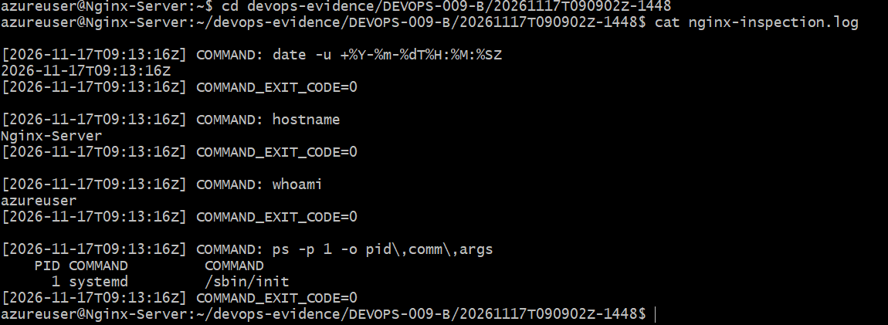
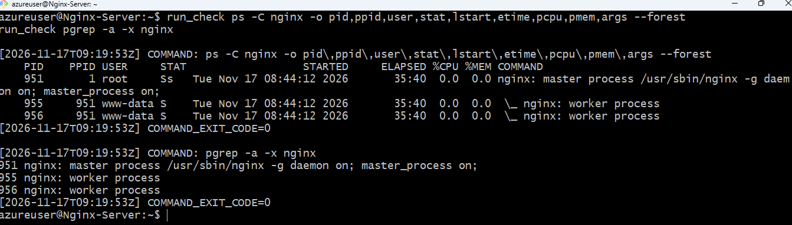
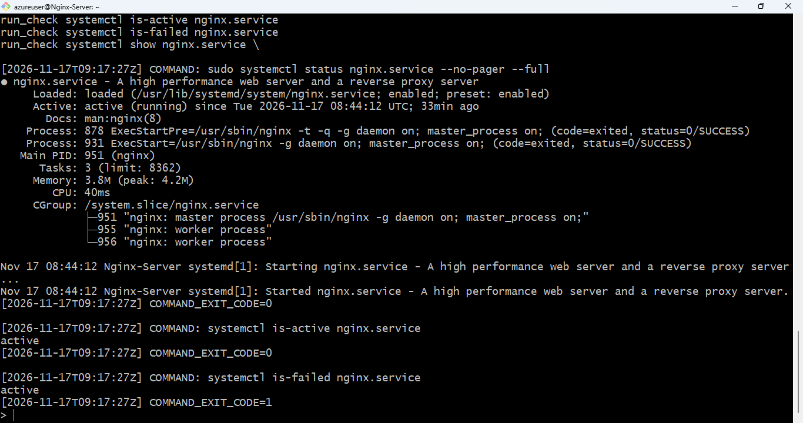
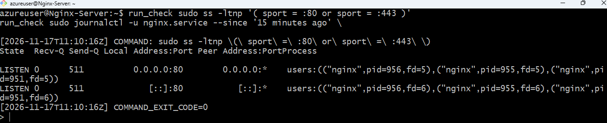
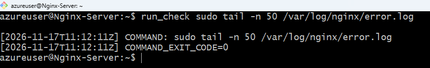
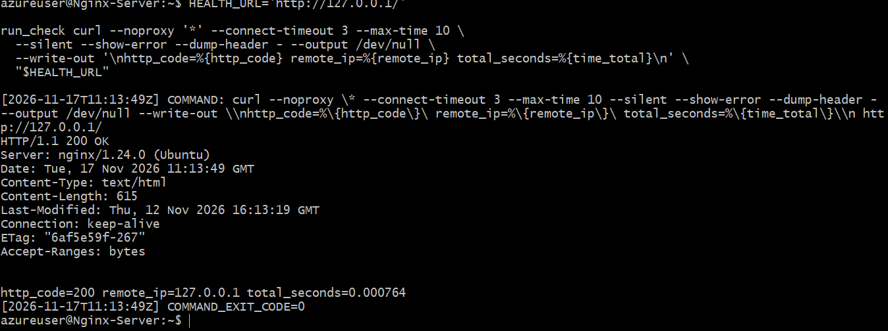
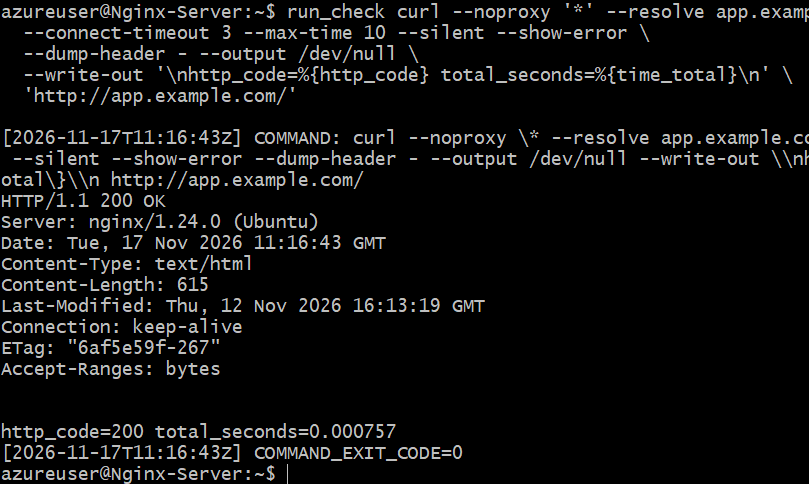
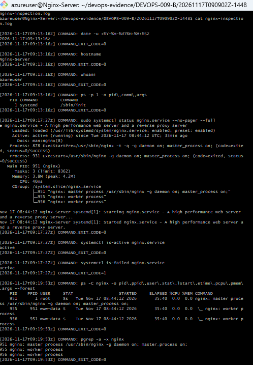

# DEVOPS-009-B: Inspect nginx Service State and Runtime Process Information

## Purpose

Determine whether the systemd-managed nginx service is running, inspect its master and worker processes, and record an evidence-based health assessment. Capture real UTC timestamps, command output, and exit codes for each check.

**Suggested repository path:** `docs/linux/nginx-service-state-and-process-inspection.md`


## Prerequisites and scope

- Run the inspection in Bash on the Linux server hosting nginx, using SSH if necessary. Windows Git Bash can manage the repository but cannot inspect the remote server's services directly.
- This procedure assumes a conventional nginx installation managed by `nginx.service` under systemd, with `ps`, `pgrep`, `ss`, `curl`, and `sudo` available.
- Use an account authorized to inspect the service and read its logs. Missing permissions or missing tools mean a check is incomplete; they do not prove nginx is down.
- Keep the same Bash session for all steps so the timestamp function and evidence path remain available.
- Capture the existing failure before making repairs. Do not start, stop, restart, reload, kill, or reconfigure nginx during this ticket.
- Use the endpoint and expected response from DEVOPS-009-A where available. A local request checks local behavior; it does not prove clients can reach the service externally.

## Step 1 — Initialize timestamped evidence capture

Run the following on the Linux server. Timestamps use ISO 8601 UTC, for example `2026-11-17T09:30:00Z`; actual values are generated when you run each command.

```bash
umask 077
INSPECTION_STARTED_AT=$(date -u +'%Y-%m-%dT%H:%M:%SZ')
EVIDENCE_DIR="$HOME/devops-evidence/DEVOPS-009-B/$(date -u +'%Y%m%dT%H%M%SZ')-$$"
mkdir -p "$EVIDENCE_DIR"
EVIDENCE_FILE="$EVIDENCE_DIR/nginx-inspection.log"
touch "$EVIDENCE_FILE"

run_check() {
  local command_rc
  {
    printf '\n[%s] COMMAND:' "$(date -u +'%Y-%m-%dT%H:%M:%SZ')"
    printf ' %q' "$@"
    printf '\n'
    if "$@"; then
      command_rc=0
    else
      command_rc=$?
    fi
    printf '[%s] COMMAND_EXIT_CODE=%s\n' \
      "$(date -u +'%Y-%m-%dT%H:%M:%SZ')" "$command_rc"
  } 2>&1 | tee -a "$EVIDENCE_FILE"
}

run_check date -u +'%Y-%m-%dT%H:%M:%SZ'
run_check hostname
run_check whoami
run_check ps -p 1 -o pid,comm,args
printf 'Evidence file: %s\n' "$EVIDENCE_FILE"
```

`run_check` saves the command, output, errors, and completion timestamp. It deliberately continues after unsuccessful checks so an inactive service does not prevent further investigation. Read the logged `COMMAND_EXIT_CODE`; the wrapper's own exit status reflects the logging pipeline rather than the inspected command.

Confirm PID 1 is systemd before continuing. If it is another init process or nginx is container-managed, record that mismatch and use the platform's service inspection workflow. A systemctl connection error alone is not evidence of an nginx outage.

If `mkdir`, `touch`, or `tee` reports an error, resolve the evidence-path problem before relying on the log.

### Output


## Step 2 — Check the nginx service state

```bash
run_check sudo systemctl status nginx.service --no-pager --full
run_check systemctl is-active nginx.service
run_check systemctl is-failed nginx.service
run_check systemctl show nginx.service \
  --property=LoadState,ActiveState,SubState,MainPID,Result,ExecMainCode,ExecMainStatus,ActiveEnterTimestamp,FragmentPath,ControlGroup
```

Record the state, main PID, service start time, and any reported failure.

### Output


| Observation | Interpretation |
| --- | --- |
| `LoadState=loaded`, `ActiveState=active`, `SubState=running` | The service manager reports nginx running; process and request checks are still required. |
| `ActiveState=inactive` | The unit is currently stopped. Investigate why; do not assume a crash. |
| `ActiveState=failed` | The unit has failed; correlate the failure details with logs. |
| `activating`, `deactivating`, or `reloading` | The service is transitioning. Capture another timestamped observation before deciding its steady state. |
| `LoadState=not-found` | This unit was not found. Check whether the expected host, service name, and deployment model are correct. |
| `MainPID=0` | systemd has no current main PID recorded for this unit. Compare with the process list. |

`is-active` returns zero for an active unit. **`is-failed` returns zero when the unit is failed.** Interpret the printed state alongside the exit code; zero does not always mean healthy. Boot enablement, if shown, is separate from current runtime health.

## Step 3 — List running nginx processes

```bash
run_check ps -C nginx -o pid,ppid,user,stat,lstart,etime,pcpu,pmem,args --forest
run_check pgrep -a -x nginx
```

### Output


For a standard nginx deployment, look for a master process and its worker processes. The workers normally have the master's PID as their parent PID. Additional cache manager or cache loader processes can be legitimate.

| Field | What to record |
| --- | --- |
| `PID` / `PPID` | Process identity and parent-child relationship. |
| `USER` | Master and worker ownership; compare with the intended installation. |
| `STAT` | Snapshot state: `S` can be normal waiting, `R` means running/runnable, and `Z` means zombie. A single state does not establish health. |
| `STARTED` / `ELAPSED` | Process start time and lifetime; compare with the reported outage. |
| `%CPU` / `%MEM` | Resource clues. One snapshot is not enough to diagnose resource exhaustion. |
| `COMMAND` | Identify master, workers, and startup arguments. |

`pgrep` exit code `1` means no matching process was found; distinguish this from an invocation or permission error. A process list can change between commands, so correlate timestamps.

## Step 4 — Match systemd's main PID to the runtime processes

```bash
run_check systemctl show nginx.service --property=MainPID --value
NGINX_MAIN_PID=$(systemctl show nginx.service --property=MainPID --value)

if [[ "$NGINX_MAIN_PID" =~ ^[1-9][0-9]*$ ]]; then
  run_check ps -p "$NGINX_MAIN_PID" \
    -o pid,ppid,user,stat,lstart,etime,args
  run_check ps --ppid "$NGINX_MAIN_PID" \
    -o pid,ppid,user,stat,lstart,etime,args
else
  run_check printf '%s\n' \
    "No usable systemd main PID was returned: [$NGINX_MAIN_PID]. See service and process evidence."
fi
```

### Output

Confirm that the main PID belongs to the expected nginx master and that expected workers exist beneath it. Worker count and ownership depend on configuration; do not require an arbitrary number of workers.

If nginx processes exist while this unit is inactive, investigate their ownership and deployment model. They may belong to another service, a manual invocation, or a container. Do not stop them based on the name alone. If a PID disappears during inspection, record the race and repeat Steps 2–4 with new timestamps.

## Step 5 — Correlate listeners and recent logs

For a typical HTTP/HTTPS lab:

```bash
run_check sudo ss -ltnp '( sport = :80 or sport = :443 )'
run_check sudo journalctl -u nginx.service --since '15 minutes ago' \
  --utc --no-pager -o short-iso-precise -n 100
```
### Output

Replace the ports if your service uses custom listeners. Confirm the expected address and port are bound and correlate the owning PID with nginx. A listener owned by another process does not confirm nginx health. For containerized deployments, host-level port ownership can differ from the service process.

Look for failed starts, unexpected exits, permission errors, or bind failures. A clean journal does not prove the application is healthy: request errors may be in nginx's configured error log. For a standard Ubuntu package installation, optionally capture:

```bash
run_check sudo tail -n 50 /var/log/nginx/error.log
```

### Output

If this file is missing, record that result and locate the configured log destination. The timestamped wrapper records when the tail was captured; preserve the original log timestamps and note their timezone if known. Historical errors alone do not prove a current failure.

## Step 6 — Check request behavior before assigning health

Use the endpoint tested in DEVOPS-009-A. For a default local HTTP lab, the commands below perform a GET, display response headers, discard the body, and record status and timing:

```bash
HEALTH_URL='http://127.0.0.1/'

run_check curl --noproxy '*' --connect-timeout 3 --max-time 10 \
  --silent --show-error --dump-header - --output /dev/null \
  --write-out '\nhttp_code=%{http_code} remote_ip=%{remote_ip} total_seconds=%{time_total}\n' \
  "$HEALTH_URL"
```
### Output 

Set the URL to the correct scheme, address, port, and path for your lab. Use the correct virtual-host name when required. For example, after substituting your actual hostname:

```bash
# Example for a name-based local HTTP virtual host; replace app.example.com.
run_check curl --noproxy '*' --resolve app.example.com:80:127.0.0.1 \
  --connect-timeout 3 --max-time 10 --silent --show-error \
  --dump-header - --output /dev/null \
  --write-out '\nhttp_code=%{http_code} total_seconds=%{time_total}\n' \
  'http://app.example.com/'
```
### Output

For HTTPS, use the real hostname and appropriate `--resolve` entry where necessary so Host, TLS SNI, and certificate validation match. Keep certificate verification enabled.

This curl command intentionally does not use `--fail`: HTTP `4xx` or `5xx` responses may still have command exit code `0`. Assess the HTTP code against the endpoint's expected response. Connection refusal or timeout does not establish a root cause by itself.

A `200` from the nginx welcome page proves only that page responded. If the ticket concerns an application behind nginx, check that application's agreed health endpoint and expected content as well. This header-only capture does not verify response content; record any additional content check needed for your application separately.

## Step 7 — Record the conclusion and close the capture

```bash
run_check systemctl is-active nginx.service
run_check ps -C nginx -o pid,ppid,user,stat,etime,args
run_check date -u +'%Y-%m-%dT%H:%M:%SZ'
printf 'Inspection began: %s\nEvidence file: %s\n' \
  "$INSPECTION_STARTED_AT" "$EVIDENCE_FILE"
```
### Outputs

Choose a conclusion supported by the checks:

| Finding | Appropriate conclusion |
| --- | --- |
| Active/running, expected master/workers, correct listener, expected endpoint response | Active and healthy for the tested endpoint at the recorded time. |
| Active/running with unexpected process, listener, or request results | Active, but health is impaired or requires further investigation. Record the failing check. |
| Inactive/failed and no expected nginx processes | The systemd-managed nginx service is down. Record the observed state and evidence. |
| Unit/process mismatch, missing access, missing tools, or an untested endpoint | Health is unconfirmed. Record the limitation and next required check. |

A down service can satisfy this inspection ticket when the outage is accurately demonstrated and documented. Completion means the state is established; service recovery belongs to the follow-up work.

## Findings template — replace placeholders with actual observations

| Item | Observed value |
| --- | --- |
| Ticket | DEVOPS-009-B |
| Engineer | `<name>` |
| Host/environment | `<hostname and lab/environment>` |
| Inspection start/end (UTC) | `<actual timestamps>` |
| Evidence file | `<actual file path or approved evidence link>` |
| LoadState / ActiveState / SubState | `<values>` |
| Service Result and exit details | `<values and interpretation>` |
| systemd MainPID / observed master PID | `<values; do they match?>` |
| Workers and parent PIDs | `<actual PIDs and relationship>` |
| Runtime/resource observations | `<states, start times, anomalies>` |
| Expected/observed listener | `<address, port, owning PID>` |
| Relevant log entries | `<timestamp, message, or no relevant entries found>` |
| Tested URL and expected response | `<actual endpoint and expectation>` |
| curl result | `<exit code, HTTP code, duration, content-check result if needed>` |
| Final assessment | `<active and healthy / active with impaired health / down / unconfirmed>` |
| Evidence supporting assessment | `<specific observations with UTC timestamps>` |
| Next action | `<follow-up investigation or recovery ticket>` |

## Acceptance criteria checklist

- [ ] Checked nginx service status using `systemctl` and recorded the timestamped state.
- [ ] Inspected nginx runtime processes using `ps` and `pgrep`.
- [ ] Correlated the service MainPID with the master and worker processes, or documented a mismatch/absence.
- [ ] Recorded listener, log, and request observations supporting the health conclusion.
- [ ] Confirmed whether nginx is active and healthy, down, impaired, or unconfirmed, with reasons.
- [ ] Replaced all evidence placeholders with actual results and recorded limitations.
- [ ] Preserved the original outage state during inspection.

## Repository handoff

Place this guide at the suggested repository path and commit it on the branch for this ticket. Keep the raw evidence log outside the repository unless the project requires it; link or attach reviewed evidence to Jira/your PR. Review hostnames, IP addresses, paths, and request/log content before sharing.

The checklist is intentionally incomplete until the inspection has been performed. Do not present example values or this procedure as proof that the server was inspected.

## Linked work items

- **DEVOPS-009-A:** Confirm the Linux Service Outage and Capture Baseline Evidence — reuse its endpoint and compare the symptoms and timestamps.
- Additional links: `<add actual Jira/PR links if applicable>`.

## References

- [systemd: systemctl](https://www.freedesktop.org/software/systemd/man/256/systemctl.html)
- [nginx: Beginner's Guide — master and worker processes](https://nginx.org/en/docs/beginners_guide.html)
- On the inspected host: `man ps`, `man pgrep`, `man ss`, `man journalctl`, and `man curl` for locally installed command options.

